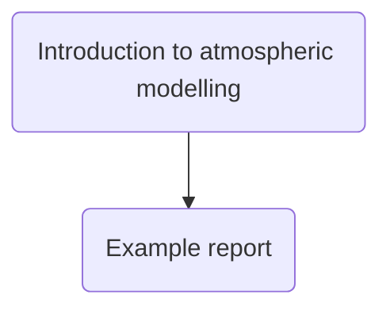

# Modelling the atmosphere

Developing mathematical models to predict the weather is notoriously challenging. Predicting how the climate will evolve in the future is even more challenging. 
One reason why this problem is so difficult is that we only have one atomsphere to study. This limitation means that we cannot run controlled repeatable experiments
on a parallel Earth as would be done in many other disciplines. In addition, it also makes it difficult to generate the large sample sizes that allow us to establish 
high confidence in statistical predictions. 

Despite all these challenges, however, there is near universal agreement amongst scientists that __human activity is causing the climate change.__ If you are interested
in understanding why you can work through the resources below.

